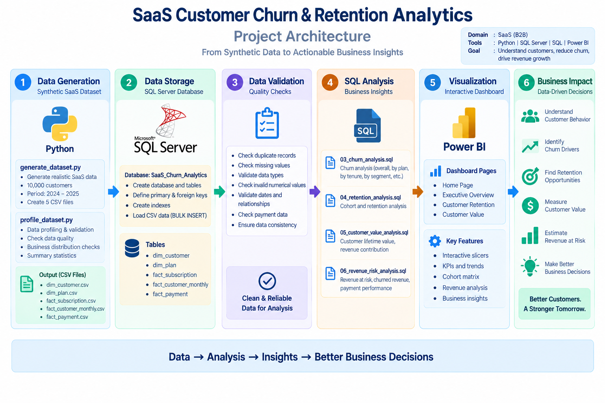
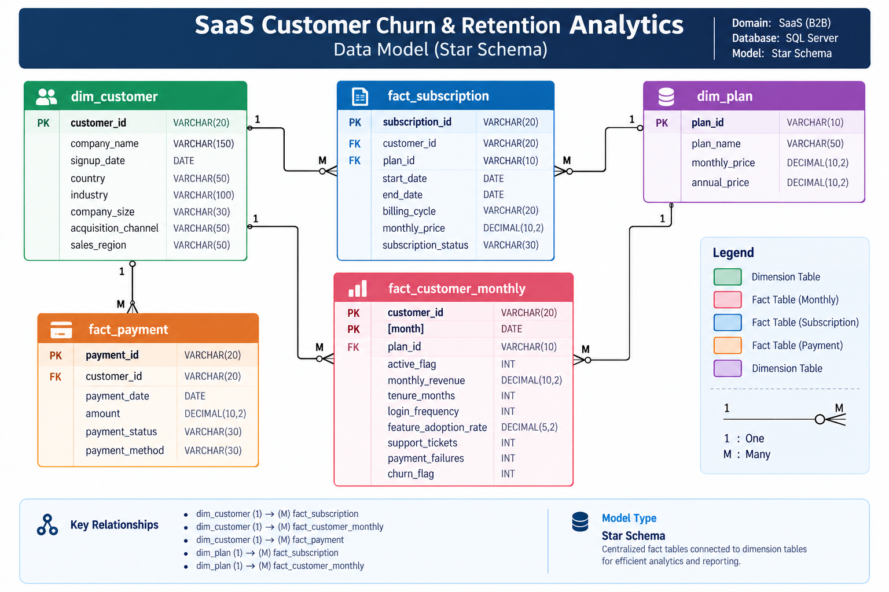
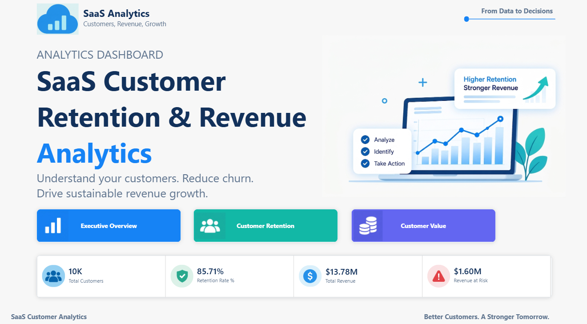
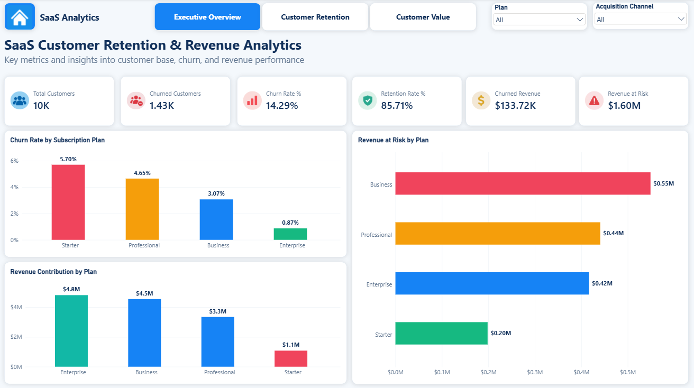
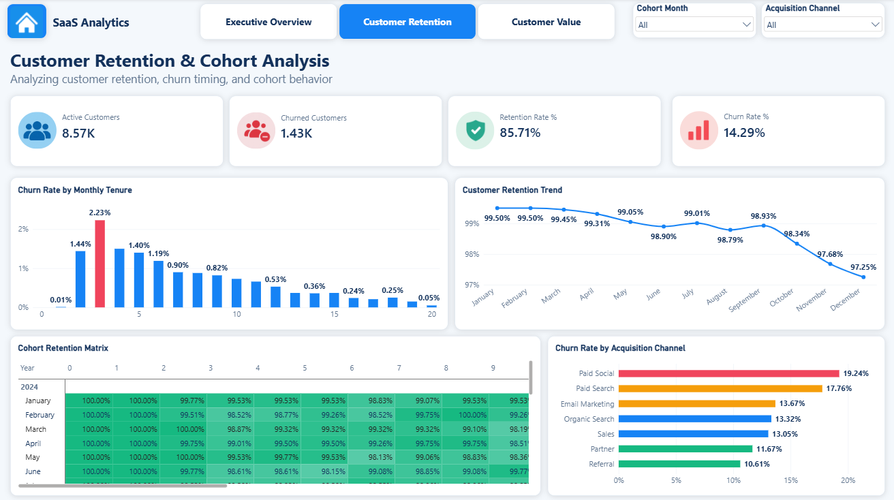
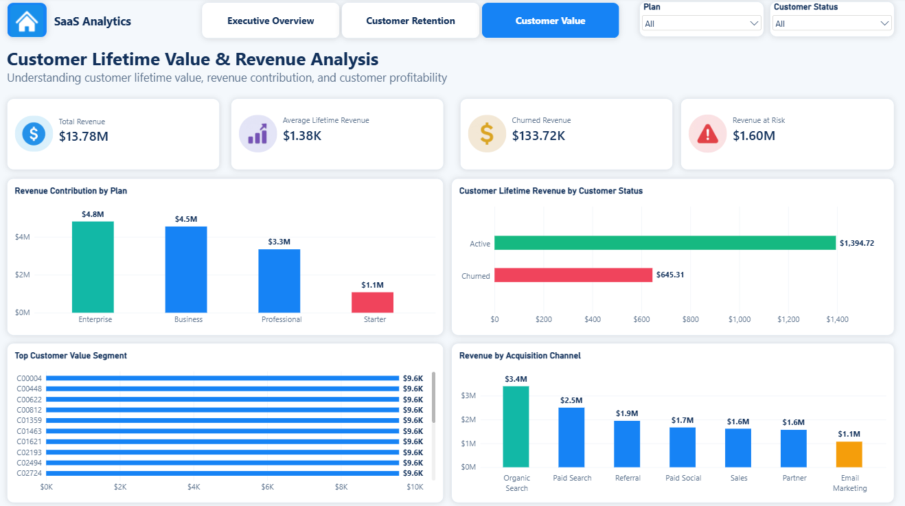

# SaaS Customer Retention & Revenue Analytics

> An end-to-end SaaS analytics project using Python, SQL Server, and Power BI to analyze customer churn, retention, lifetime revenue, and revenue at risk.

## Table of Contents

1. [Overview](#overview)
2. [Problem Statement](#problem-statement)
3. [Dataset](#dataset)
4. [Tools and Technologies](#tools-and-technologies)
5. [Methods](#methods)
6. [Key Insights](#key-insights)
7. [Dashboard, Model, and Output](#dashboard-model-and-output)
8. [How to Run This Project](#how-to-run-this-project)
9. [Results and Conclusion](#results-and-conclusion)
10. [Future Work](#future-work)
11. [Author and Contact](#author-and-contact)
12. [GitHub Repository Structure](#github-repository-structure)

---

## Overview

SaaS businesses need to understand why customers leave, which customer groups are at higher risk, how retention changes over time, and how much revenue may be affected by churn.

This project builds an end-to-end analytics workflow that prepares SaaS customer data with Python, stores and analyzes it in SQL Server, and presents the findings through an interactive Power BI dashboard.

### Project Architecture

**Source Data → Python Data Generation and Preparation → SQL Server → SQL Analysis → Power BI Dashboard → Business Insights**



## Problem Statement

The business needs a clear view of customer churn and its potential effect on recurring revenue. The analysis focuses on these questions:

- How many customers are churning, and what is the churn rate?
- Which subscription plans and acquisition channels have higher churn?
- How does retention change over time and across customer cohorts?
- Which plans and acquisition channels contribute the most revenue?
- How much revenue has been lost or is at risk?
- How does customer lifetime revenue differ by customer status?

The goal is to help management identify high-risk customer groups and prioritize retention and revenue-protection efforts.

## Dataset

The project uses structured SaaS data covering five areas. The CSV files are stored in `data/raw/`.

| File | Description |
|---|---|
| `dim_customer.csv` | Customer and company details, including industry, size, country, acquisition channel, and sales region |
| `dim_plan.csv` | Subscription plan names and prices |
| `fact_subscription.csv` | Subscription dates, billing cycles, prices, and statuses |
| `fact_customer_monthly.csv` | Monthly customer activity, revenue, tenure, feature adoption, support tickets, payment failures, and churn indicators |
| `fact_payment.csv` | Payment dates, amounts, statuses, and methods |

The data is used for portfolio and analytical demonstration purposes.

## Tools and Technologies

| Tool / Technology | Purpose |
|---|---|
| Python | Dataset generation, preparation, and profiling |
| Pandas | Tabular data processing |
| SQL Server | Relational database storage |
| T-SQL | Data validation and business analysis |
| Power BI | Interactive dashboards and visual reporting |
| DAX | KPI and analytical measure calculations |
| GitHub | Version control and project documentation |

## Methods

1. **Data generation and preparation:** Use Python scripts to generate and prepare the project datasets.
2. **Database design:** Create the `SaaS_Churn_Analytics` database, tables, primary keys, foreign keys, and analytical indexes in SQL Server.
3. **Data loading:** Load the five CSV datasets into their corresponding SQL Server tables.
4. **Data validation:** Check duplicate records, missing values, invalid numerical values, churn flags, subscription dates, and payment amounts.
5. **SQL analysis:** Analyze churn, retention and cohorts, customer value, and revenue risk.
6. **Power BI modeling and reporting:** Build relationships, define measures, and present KPIs and analysis in four dashboard pages.

### Data Model

The database contains two dimension tables and three fact tables.



- **Dimension tables:** `dim_customer`, `dim_plan`
- **Fact tables:** `fact_subscription`, `fact_customer_monthly`, `fact_payment`

The customer dimension connects to all three fact tables. The plan dimension connects to subscription and monthly customer data.

## Key Insights

The dashboard highlights the following findings in the displayed analysis:

- **Starter has the highest churn rate** among the subscription plans shown.
- **Enterprise has the lowest churn rate** and the highest revenue contribution among the plans shown.
- **Paid Social has the highest churn rate** among the acquisition channels shown.
- Revenue at risk is concentrated across the **Business and Professional plans**, so these plans are important for revenue-risk monitoring.
- The displayed customer retention trend declines toward the later months.
- Customer tenure and acquisition channel help identify customer groups that may need closer retention monitoring.

### Headline Dashboard Metrics

| Metric | Displayed value |
|---|---:|
| Total customers | 10K |
| Churned customers | 1.43K |
| Churn rate | 14.29% |
| Retention rate | 85.71% |
| Total revenue | $13.78M |
| Churned revenue | $133.72K |
| Revenue at risk | $1.60M |

*Values are taken from the project dashboard screenshots. Monetary values are displayed in US dollars.*

For interpretation and recommendations, see [`docs/business_insights.md`](docs/business_insights.md).

## Dashboard

The Power BI report contains four pages.

### 1. Home Page

Provides navigation and high-level KPIs for total customers, retention rate, total revenue, and revenue at risk.



### 2. Executive Overview

Summarizes customer and revenue performance using customer, churn, retention, and revenue-risk KPIs. Visuals include churn rate by plan, revenue at risk by plan, and revenue contribution by plan. Filters include plan and acquisition channel.



### 3. Customer Retention

Examines active and churned customers, retention and churn rates, churn by tenure, retention trends, cohort retention, and churn by acquisition channel. Filters include cohort month and acquisition channel.



### 4. Customer Value

Examines total revenue, average lifetime revenue, churned revenue, and revenue at risk. Visuals include revenue contribution by plan, lifetime revenue by customer status, top customer value segments, and revenue by acquisition channel. Filters include plan and customer status.



### Main Output Files

- Power BI report: [`powerbi/SaaS_Churn_Retention.pbix`](powerbi/SaaS_Churn_Retention.pbix)
- Project architecture: [`docs/project_architecture.png`](docs/project_architecture.png)
- Data model: [`docs/data_model.png`](docs/data_model.png)
- Business insights: [`docs/business_insights.md`](docs/business_insights.md)
- Dashboard guide: [`docs/dashboard_guide.md`](docs/dashboard_guide.md)
- Data dictionary: [`docs/data_dictionary.md`](docs/data_dictionary.md)

## How to Run This Project

### Prerequisites

- Python installed
- Microsoft SQL Server and SQL Server Management Studio (SSMS)
- Power BI Desktop

### Steps

1. **Clone or download the repository.**
   ```bash
   git clone https://github.com/Pronoy-2003/saas-customer-churn-retention-analytics.git
   cd saas-customer-churn-retention-analytics
   ```

2. **Install Python dependencies.**
   ```bash
   pip install -r requirements.txt
   ```

3. **Generate and profile the datasets.** Run the Python scripts in the `python/` directory as needed:
   ```bash
   python python/generate_dataset.py
   python python/profile_dataset.py
   ```
   Confirm the generated CSV files are saved in `data/raw/`.

4. **Create the database and tables.** Open `sql/01_database_schema.sql` in SSMS and execute it.

5. **Load the CSV data into SQL Server.** Use the import process or the `BULK INSERT` statements if included in your local SQL setup. If using `BULK INSERT`, update the file paths to match your machine and ensure SQL Server can access those files. Load dimension tables before fact tables.

6. **Validate the data.** Execute `sql/02_data_validation.sql` and review the results.

7. **Run the analytical SQL scripts.**
   - `sql/03_churn_analysis.sql`
   - `sql/04_retention_analysis.sql`
   - `sql/05_customer_value_analysis.sql`
   - `sql/06_revenue_risk_analysis.sql`

8. **Open the Power BI report.** Open `powerbi/SaaS_Churn_Retention.pbix`, configure the SQL Server connection for your environment, and refresh the data.

> **Note:** Database connection settings and local CSV paths may need to be updated before running the project. Do not commit credentials or other sensitive connection details.

## Results and Conclusion

This project combines data preparation, relational database design, data validation, SQL analysis, KPI development, and Power BI reporting in one workflow. It provides a consolidated view of churn, retention, customer value, and revenue at risk, helping stakeholders identify areas for further investigation and potential retention action.

The results are descriptive and diagnostic; the project does not currently include a predictive churn model.

## Future Work

- **Predictive churn modeling:** Build and evaluate a machine-learning model to identify customers at risk of churning.
- **Automated data pipeline:** Automate dataset loading, validation, and refresh workflows.
- **Deeper churn-driver analysis:** Investigate how usage, feature adoption, support tickets, and payment failures relate to churn.
- **Enhanced Power BI experience:** Add drill-through pages, richer tooltips, and more detailed customer segmentation.
- **Retention recommendations:** Develop targeted retention actions for high-risk customer segments.


## GitHub Repository Structure

```text
saas-customer-churn-retention-analytics/
│
├── data/
│   └── raw/
│       ├── dim_customer.csv
│       ├── dim_plan.csv
│       ├── fact_customer_monthly.csv
│       ├── fact_payment.csv
│       └── fact_subscription.csv
│
├── docs/
│   ├── business_insights.md
│   ├── dashboard_guide.md
│   ├── data_dictionary.md
│   ├── data_model.png
│   └── project_architecture.png
│
├── powerbi/
│   └── SaaS_Churn_Retention.pbix
│
├── python/
│   ├── generate_dataset.py
│   └── profile_dataset.py
│
├── screenshots/
│   ├── 01_home_page.png
│   ├── 02_executive_overview.png
│   ├── 03_customer_retention.png
│   └── 04_customer_value.png
│
├── sql/
│   ├── 01_database_schema.sql
│   ├── 02_data_validation.sql
│   ├── 03_churn_analysis.sql
│   ├── 04_retention_analysis.sql
│   ├── 05_customer_value_analysis.sql
│   └── 06_revenue_risk_analysis.sql
│
├── .gitignore
├── LICENSE
├── README.md
└── requirements.txt
```


## Author and Contact

**Pronoy Pryunkush Sonowal**

-   **GitHub:** https://github.com/Pronoy-2003
-   **LinkedIn:** www.linkedin.com/in/pronoy-pryunkush-sonowal
-   **Email:** pronoypryunkushsonowal2002@gmail.com
